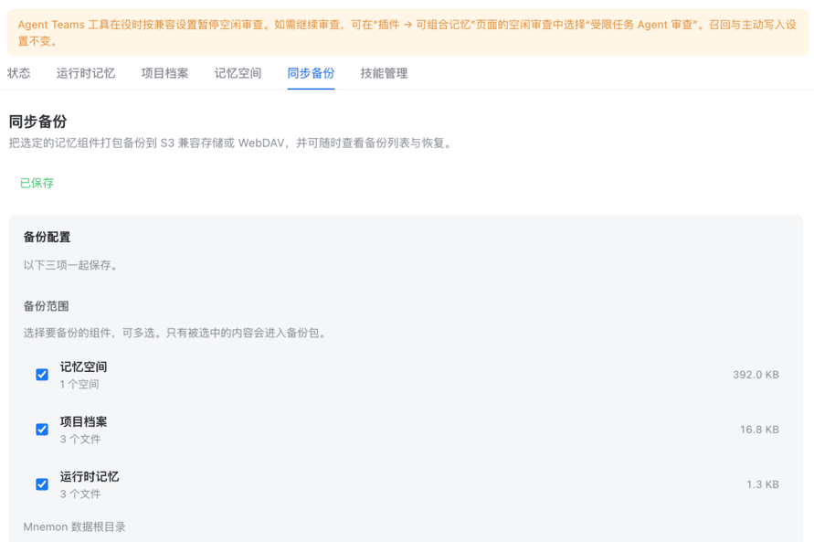

<div align="center">

# dsh-mnemon-sync

<!-- release-state-note -->

**Back up and restore dsh-mnemon memory — archive it to S3-compatible storage or WebDAV, then pick a snapshot to bring back.**

[](https://www.npmjs.com/package/@summerscar/dsh-mnemon-sync)
[](https://www.npmjs.com/package/@summerscar/dsh-mnemon-sync)
[](https://awesome-dsh-plugin.com)
[](LICENSE)
[](https://github.com/deepseek-ai/deepseek-harness)
[](https://dshopen.org/zh/plugins/@summerscar/dsh-mnemon-sync/)

[简体中文](docs/README.zh-CN.md) · English

</div>

---

`dsh-mnemon` keeps long-term memory in local SQLite databases and Markdown files, and DSH keeps your skills as `SKILL.md` folders on disk. This plugin adds **off-site backup** and **on-demand restore** for both: once installed, the memory system gains a "Sync backup" tab.



## Install

```sh
dsh plugin --profile web add @summerscar/dsh-mnemon-sync
```

Restart DSH, then open the memory system to find "Sync backup". The plugin still runs without `dsh-mnemon` installed — it just cannot show its tab.

> **Desktop:** install it from the desktop app's plugin page. The `desktop` profile is managed exclusively by the Electron app; `dsh plugin --profile desktop` is rejected by DSH itself.

## What it does

Pick any subset of five components. The original three are selected by default; both skill components start unselected, because carrying a machine's skills is a deliberate act — a restore writes into the skill roots, so it should not happen as a side effect of the first backup:

| Component | Contents | Default |
|---|---|---|
| Memory spaces | `<MNEMON_DATA_DIR>/data/`, one `mnemon.db` per space plus the registry | selected |
| Project documents | `<MNEMON_DATA_DIR>/documents/`, `index.json` and every Markdown file | selected |
| Runtime memory | `<MNEMON_DATA_DIR>/runtime/`, `memories.json` and both projections | selected |
| Skill files | The real skill trees under `$DSH_HOME/skills` and `$DSH_AGENTS_HOME/skills` | not selected |
| Skill data | `<MNEMON_DATA_DIR>/skills/`: `ledger.json`, `evals.json`, `versions/`, `trajectories/`, `market/`, `trash/` | not selected |

Skills are split into two components because they behave differently: a `SKILL.md` is what makes the model capable, so it must travel to a new machine, while the ledger and trajectories are local evolution history that is large and recomputable — leave it off if you would rather not upload it.

**Project-level skills are out of scope.** `<project>/.dsh/skills` and `<project>/.agents/skills` belong to a repository and travel with git. Copying them into a memory backup would give the same content a second source of truth, and a restore could overwrite your checkout, so only the user's own layer is backed up.

Archives go to S3-compatible storage (Cloudflare R2, MinIO, Backblaze B2, Aliyun OSS …) or a WebDAV server, on a timer from hourly to weekly. You can list the archives already on the target, inspect one, and restore only the components you choose. Restore previews by default; every file is SHA-256 verified before upload and again before restore, and live databases are copied through `node:sqlite`'s online `backup()`.

OS bookkeeping files (`.DS_Store`, `Thumbs.db`, `desktop.ini`, `._*` resource forks, editor `.swp` / `~` backups) are never packed. An older archive that carries them still restores — those entries are skipped rather than failing the run.

Credentials live in a `0600` file outside the DSH profile and are never packed into an archive. No runtime dependencies outside Node.

## Configuration

Everything is set on the "Sync backup" page. Saved secrets are shown only as a mask; leaving the mask (or the field) unchanged keeps the stored value.

The memory directory is detected automatically (`MNEMON_DATA_DIR`, else `~/.mnemon`) and the page always shows what is actually being read. dsh-mnemon's storage root is not always the default one — its `storageScope` may also be `workspace`, `custom` or `workspaces` — and a third-party Source is never told which, so the backup scope offers a custom data directory field. Leave it blank to auto-detect; fill it in to read exactly that directory.

See the [中文说明](docs/README.zh-CN.md) for field-by-field examples for S3 / Cloudflare R2 and WebDAV.

## Development

This repository is a pnpm monorepo; the plugin lives in `plugins/dsh-mnemon-sync/`.

```sh
git clone https://github.com/summerscar/dsh-plugins.git
cd dsh-plugins
pnpm install
pnpm --filter @summerscar/dsh-mnemon-sync test
pnpm check
```

The code is the developer documentation.

## License

[SATA 2.1](LICENSE). Versions up to and including 0.1.11 published on npm remain MIT.
