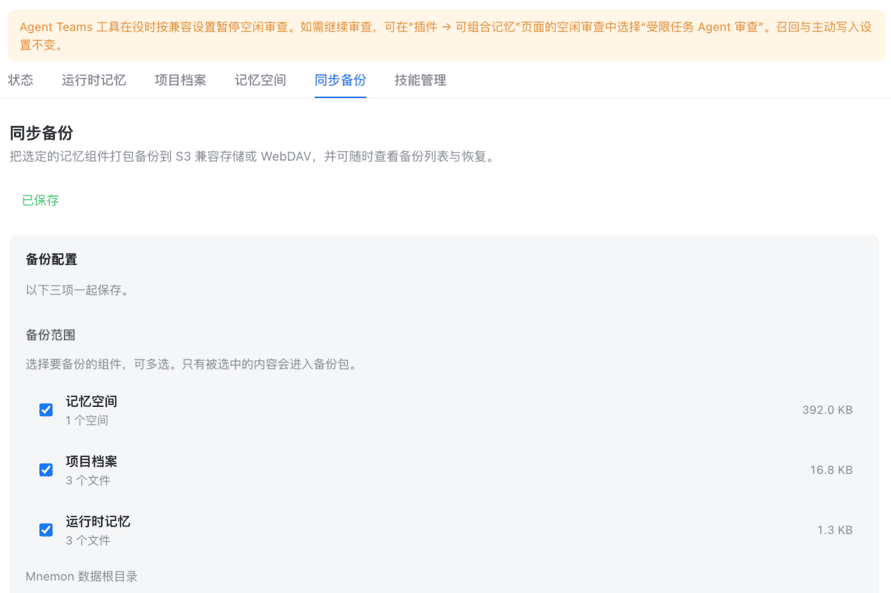

<div align="center">

# dsh-mnemon-sync

**为 dsh-mnemon 的记忆做备份与恢复 —— 打包到 S3 兼容存储或 WebDAV，随时挑一个包还原回来。**

[](https://www.npmjs.com/package/@summerscar/dsh-mnemon-sync)
[](https://www.npmjs.com/package/@summerscar/dsh-mnemon-sync)
[](../LICENSE)
[](https://github.com/deepseek-ai/deepseek-harness)
[](https://dshopen.org/zh/plugins/@summerscar/dsh-mnemon-sync/)

[快速开始](#快速开始) · [功能](#功能) · [配置](#配置) · [常见问题](#常见问题) · [更新日志](../CHANGELOG.md)

</div>

---

`dsh-mnemon` 把长期记忆存在本地 SQLite 和一批 Markdown 文件里。这个插件给它们加上**异地备份**和**按需恢复**：装好后在记忆系统里多一个「同步备份」标签页。



```
记忆系统 → 同步备份
  ├── 备份范围   记忆空间 / 项目档案 / 运行时记忆（可任选）
  ├── 备份目标   S3 兼容存储 或 WebDAV
  ├── 自动备份   关闭 · 每小时 · 3/6/12 小时 · 每天 · 3/7 天
  └── 备份列表   查看明细 · 选择组件恢复
```

## 快速开始

```sh
dsh plugin --profile web add @summerscar/dsh-mnemon-sync
```

重启 DSH，打开记忆系统即可看到「同步备份」。没装 `dsh-mnemon` 时插件仍可运行，只是不显示标签页。

> **Desktop 版**：在桌面应用的插件界面里安装即可。`desktop` profile 由 Electron 应用独占管理，命令行 `dsh plugin --profile desktop` 会被拒绝，这是 dsh 自身的限制。

## 功能

**三个组件，任意组合**（默认全选）

| 组件 | 内容 |
|---|---|
| 记忆空间 | `<MNEMON_DATA_DIR>/data/`，每个空间的 `mnemon.db` 与空间清单 |
| 项目档案 | `<MNEMON_DATA_DIR>/documents/`，`index.json` 与全部 Markdown |
| 运行时记忆 | `<MNEMON_DATA_DIR>/runtime/`，`memories.json` 与两份投影 |

`MNEMON_DATA_DIR` 未设置时取 `~/.mnemon`。

**两种备份目标**

- **S3 兼容** — 手写 AWS Signature V4，适用于 Cloudflare R2、MinIO、Backblaze B2、阿里云 OSS 等
- **WebDAV** — Basic 认证，自动创建远端目录

**备份文件按设备区分**

```
mnemon-sync-<设备名>-2026-11-09T01-20-27.875Z.zip
```

设备名取自 dsh-mnemon 的 `state/machine.json`，多台机器备份到同一目录也能一眼分辨来源。

**一致性有保证**

- 数据库走 `node:sqlite` 的 `backup()` 在线备份，写入方的 WAL 不会把副本撕开
- 每个文件记录 SHA-256，上传前自校验，恢复前再校验一次
- 恢复默认只做预览，确认后才写盘；写数据库前先删同名 `-wal` / `-shm`，避免 SQLite 重放恢复文件里没有的事务

## 配置

在「同步备份」页面填好即可，配置存在 `<MNEMON_DATA_DIR>/state/mnemon-sync.json`（权限 `0600`），不写入 DSH 配置，也不会进备份包。

<details>
<summary><b>S3 / Cloudflare R2 示例</b></summary>

| 字段 | 示例 |
|---|---|
| Endpoint | `https://<account>.r2.cloudflarestorage.com` |
| Bucket | `my-mnemon-backup` |
| Region | `auto` |
| Access Key ID | 你的 R2 Access Key |
| Secret Access Key | 你的 R2 Secret |
| 强制 path-style | R2 和 MinIO 通常需要勾选 |

</details>

<details>
<summary><b>WebDAV 示例</b></summary>

| 字段 | 示例 |
|---|---|
| 地址 | `http://192.168.100.134:5005` |
| 用户名 | 你的 WebDAV 账号 |
| 密码 | 你的 WebDAV 密码 |
| 远端目录 | `config-backup/mnemon-sync` |

> 地址带不带结尾斜杠都可以，插件会归一化。

</details>

页面只回显掩码，回传掩码表示不修改。想换密钥就直接填新值。

## 常见问题

<details>
<summary><b>装好了但看不到标签页？</b></summary>

1. **重启 DSH** —— Host 侧的 Source 注册和浏览器端代码都要重启才加载
2. 确认 `dsh-mnemon` 已安装且版本 ≥ 0.5.40
3. 确认 `dsh.profile.bundles` 里有 `@summerscar/dsh-mnemon-sync`
4. 强刷页面（Ctrl+Shift+R）绕开浏览器缓存

</details>

<details>
<summary><b>备份报 401 Not Authorized？</b></summary>

凭据问题。检查用户名密码，以及 WebDAV 服务是否真的在运行。注意有些 NAS 的 WebDAV 改配置后需要重启服务才生效。

</details>

<details>
<summary><b>为什么不用 litestream？</b></summary>

litestream 一个实例只盯一个数据库，v0.5 每个库只允许一个副本 —— 备份整个 `data` 目录就得为每个记忆空间养一个常驻进程。另外它接管 WAL checkpoint 并持锁，实测会让 `mnemon.db-wal` 停在非零字节，而 dsh-mnemon 自己的备份导出有这条检查，会直接报错：

```js
if (existsSync(wal) && statSync(wal).size > 0)
  throw new Error(`Memory Space ${id} is busy (...-wal is not checkpointed)`)
```

</details>

<details>
<summary><b>保留份数怎么算？</b></summary>

按运行时间保留最新的 N 个，超出后删除最旧的。删除依据是插件自己的运行记录，不会去 LIST 远端目录。

</details>

## 开发

```sh
git clone https://github.com/summerscar/dsh-plugins.git
cd dsh-plugins
pnpm install
pnpm --filter @summerscar/dsh-mnemon-sync test
```

| 文件 | 职责 |
|---|---|
| `index.js` | Host 入口：HTTP 接口、调度装配、备份引擎 |
| `source.js` | 承载页面身份的记忆 Source（不存记忆） |
| `snapshot.js` | 组件识别、数据库在线备份、manifest 与校验 |
| `scheduler.js` | 定时器与运行历史 |
| `store.js` | 设置存取（0600）与规范化 |
| `targets.js` | S3 SigV4 / WebDAV 的上传、下载、列目录、删除 |
| `zip.js` | 零依赖 ZIP 读写（基于 `node:zlib`） |
| `client.js` | 浏览器端页面与标签注册 |

零外部运行时依赖。

## 许可

[SATA 2.1](../LICENSE)（0.1.11 及之前发布在 npm 上的版本仍为 MIT。）
